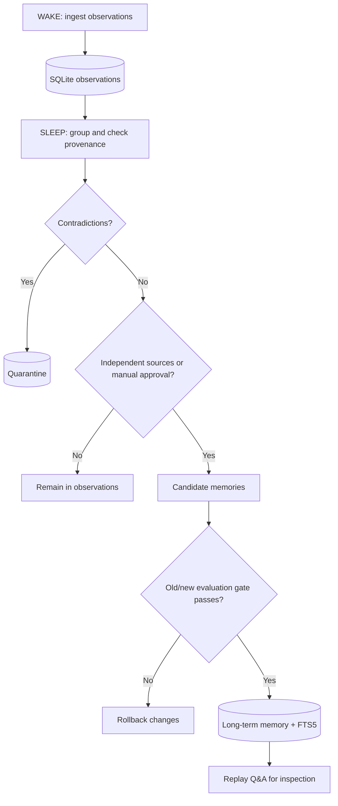

# WakeSleep Memory Lab 🌙

**A local-first, auditable wake/sleep memory prototype for AI agents, inspired by—but NOT a reproduction of—Google Research's Sleep framework.**

[](#tests)


> **Scientific honesty:** This V0.1 consolidates explicit facts into an external SQLite store. It does **not** modify LLM weights, implement Mixture-of-Experts memory, Generalized Knowledge Distillation, reinforcement learning or the paper's dreaming process. `rehearsal` only creates ground-truth-preserving Q&A. These features are research milestones, not implemented claims.

## Problem

An agent can temporarily use information in its context window, yet it needs an inspectable way to retain useful information between sessions. Naive memory pipelines silently overwrite facts or treat repetition as independent verification. This project provides a small experimental harness to measure the benefits *and limits* of external memory consolidation.

## What works today

- **Wake / ingest:** append structured observations (subject, predicate, value, provenance) to local storage.
- **Sleep / consolidate:** promote facts only when explicitly approved (`verified: true`) or supported by two *distinct* source identifiers.
- **Conflict quarantine:** different values under the same key are flagged; existing memories are never silently overwritten.
- **Replay:** generate deterministic rehearsal questions from consolidated facts; no invented facts.
- **Quality gate:** evaluate old/new fixed datasets; roll back *tentative memory changes* when thresholds fail.
- **Search:** FTS5 full-text lookup and exact-key recall with source provenance.
- **Local-only:** zero cloud API calls, no LLM or GPU necessary, standard-library runtime.

### Important limitations

- Source IDs are **not proven independent**; an operator can lie or mislabel `verified`.
- A JSONL `expected` value is a curated label, not an automatic check of truth.
- A metric here tests **exact-key memory retrieval**, not model reasoning, generalization, or catastrophic forgetting in neural parameters.
- Contradictory or changing facts stay quarantined until a future explicit resolution workflow. Time-aware validity and supersession are not implemented.
- Local SQLite is **not encrypted at rest**. Never put customer, company, health, credentials or personal information in this public repository or demo.
- No language-model extraction, no RAG answer generation, no LoRA updates, no MoE, no RL, and no guarantee of factual correctness.

## Quick start

Requirements: Python >=3.10, SQLite with FTS5 (included in common Python installations).

```bash
python -m venv .venv
source .venv/bin/activate          # Windows PowerShell: .venv\Scripts\Activate.ps1
python -m pip install -e .
wakesleep --db demo.db init
wakesleep --db demo.db ingest examples/day1.jsonl
wakesleep --db demo.db sleep
wakesleep --db demo.db ingest examples/day2.jsonl
wakesleep --db demo.db sleep --golden examples/golden.jsonl --min-old 1 --min-new 1
wakesleep --db demo.db evaluate examples/golden.jsonl
wakesleep --db demo.db search développement
wakesleep --db demo.db recall "Projet Beta" statut
wakesleep --db demo.db rehearsal --output rehearsal.jsonl
wakesleep --db demo.db stats
```

Unix alternative: `bash examples/demo.sh` (resets `demo.db`). All example data is **invented** and has no relation to real construction projects.

## Input format

One JSON object per line:

```json
{"subject":"Projet Beta","predicate":"statut","value":"en développement","source_id":"source-A","verified":false}
```

Use `observed_at` (ISO timestamp string) optionally for auditing; no temporal resolution logic yet. `verified` means **manually approved by the operator**, not independently validated by the software. A second observation of the same key/value with a genuinely independent `source_id` can satisfy the default two-source promotion rule.

## Evaluation

Golden JSONL records have `cohort` (`old`/`new`), `subject`, `predicate`, and an `expected` **string or `null`** (abstain). Example:

```json
{"cohort":"old","subject":"Projet Alpha","predicate":"statut","expected":"en préparation"}
```

The gate compares `old` exact-key accuracy before/after and can enforce minimum thresholds for `old` and `new` cohorts. A failed gate rolls back *proposed memory promotions and updates* while preserving the raw observations, audit cycle and conflicts for inspection. There is no model-weight checkpoint here.

**Measurement caution:** the toy demo is not evidence of a performance improvement over baseline RAG or the Google method. See [docs/RESEARCH_GAP.md](docs/RESEARCH_GAP.md) for a falsifiable experiment plan.

## Architecture



- [Detailed architecture](docs/ARCHITECTURE.md)
- [Fidelity map and experiment protocol](docs/RESEARCH_GAP.md)
- [Milestones](docs/ROADMAP.md)
- [Publication GitHub](docs/GITHUB_SETUP.md)

## Tests

```bash
python -m unittest discover -s tests -v
```

GitHub Actions runs tests on Python 3.10, 3.12 and 3.13 on push and pull requests.

## Research attribution

Inspired by:
- Google Research blog (2026-10-27): https://research.google/blog/the-sleep-framework-a-new-way-for-llms-to-retain-knowledge-in-continual-learning/
- Behrouz, Hashemi, Javanmard & Mirrokni, *Language Models Need Sleep: Learning to Self-Modify and Consolidate Memories*, arXiv:2606.03979: https://arxiv.org/abs/2606.03979

This project is **independent, unaffiliated with Google**, and not derived from purported official source code. Do not advertise this V0.1 as “implementing Google Sleep” or as achieving 10M-token retention.

## License

MIT, see [LICENSE](LICENSE).
